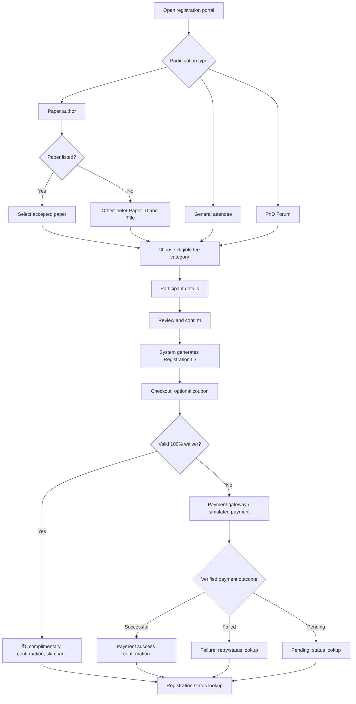

# AsianHOST 2026 — Conference Registration Portal

**Developer handoff | Source code + workflow + setup instructions**

This repository contains the **participant-facing reference website** for the 11th Asian Hardware Oriented Security and Trust Symposium (AsianHOST 2026), 11–13 December 2026, at IIT Kharagpur Research Park, Rajarhat, Kolkata.

- **Demo site:** https://siddy1992.github.io/asianhost-2026-registration-demo/
- **Source repository:** https://github.com/Siddy1992/asianhost-2026-registration-demo
- **Official conference website:** https://www.asianhost.org/2026/
- **Conference programme ID:** `IIT/CEP/CON/CON/2025-2026/CS/162`

> [!IMPORTANT]
> This is a **static prototype for the development team**, not a production registration or payment service. The registration forms, payment outcomes, coupon codes and status records are simulated in the browser. No money is collected, no email is sent, no invoice is issued, and no eligibility is verified. **Do not use this prototype to collect real registrations or payments.** A backend, database, approved payment gateway and email service are required before launch.

## 1. Getting started

### A. View the deployed demonstration

Open the [GitHub Pages demo](https://siddy1992.github.io/asianhost-2026-registration-demo/).

The site is intended to demonstrate the desired appearance, field order, validation, registration journey, coupon behavior, status lookup and confirmation screens.

### B. Run the source locally

The project uses plain HTML, CSS and JavaScript. **No Node.js, npm, build process or external database is required for the prototype.**

```bash
git clone https://github.com/Siddy1992/asianhost-2026-registration-demo.git
cd asianhost-2026-registration-demo
python3 -m http.server 8000
```

Open `http://localhost:8000/` in a browser. Stop the server with `Ctrl+C`.

Alternatively, open `index.html` directly, although a local HTTP server is preferable for consistent browser behavior. `checkout.html` requires a registration order created through the form, so do not open it as a standalone payment page.

**To reset demo registrations:** Clear the browser's local storage for the site, or use a private/incognito window. Registrations made in one browser are not available in another browser or on another device.

### C. Publish or update the GitHub Pages demonstration

1. Keep `index.html`, `checkout.html`, `app.js`, `checkout.js`, `styles.css`, `README.md`, `.nojekyll` and `assets/` in the repository root.
2. In GitHub, open **Settings → Pages**.
3. Choose **Deploy from a branch**, branch **`main`**, folder **`/(root)`**, and save.
4. After the GitHub Pages workflow completes, visit the demo URL above.
5. To update the demo, commit changed source files to `main` and allow Pages to redeploy.

**GitHub Pages hosts only the static demo.** It cannot securely generate payment orders, verify gateway callbacks, send confirmation emails or store a shared registration database.

## 2. Repository layout

| File or directory | Purpose |
|---|---|
| `index.html` | Registration steps, participant details, review, confirmation and status lookup screens |
| `app.js` | Registration categories, fees, accepted-paper list, deadline behavior, form validation, sample records, browser-local registrations and status display |
| `checkout.html` | Checkout interface and coupon entry |
| `checkout.js` | Simulated payment outcomes and **dummy** 100% coupon handling |
| `styles.css` | Responsive visual design |
| `assets/` | IIT Kharagpur and AsianHOST logos |
| `.nojekyll` | GitHub Pages configuration helper |
| `README.md` | Setup, business rules, page transitions, test data and production requirements |

The frontend is intentionally framework-free. Developers may preserve the UI while connecting it to their chosen production framework/backend.

## 3. End-to-end participant journey



### Page/screen transition reference

| From | User action / condition | Next screen / system behavior |
|---|---|---|
| Registration — Step 1 | Select purpose, paper, fee category and period; continue | Participant details — Step 2 |
| Participant details — Step 2 | Enter required information; submit | Review — Step 3 |
| Review — Step 3 | Confirm details; proceed | Registration ID created; open `checkout.html?id=...` |
| Checkout | Valid dummy 100% coupon | Mark complimentary; **no bank redirect**; confirmation |
| Checkout | No coupon; simulated success | Confirmation: payment successful |
| Checkout | No coupon; simulated failure | Confirmation: payment unsuccessful; retry possible |
| Checkout | Cancel or unresolved payment | Pending / incomplete state; check status |
| Confirmation | Check status | Registration ID + registered email lookup |
| Status lookup | Correct ID and email | Show successful, failed, pending or complimentary outcome |
| Status lookup | Eligible IEEE correction demo | Preview separate ₹10,000 balance-payment order |

The reference site shows simulated payment buttons rather than a real bank page. In production, a positive payable amount must go through the approved payment provider.

## 4. Participation types and paper selection

**Paper author:** Choose a paper from the accepted-paper dropdown. If it is missing, select **“Other — my accepted paper is not listed”** and provide both **Paper ID** and **Paper Title** (mandatory). The manual entry is saved with `paperSource: "manual"` and `paperVerification: "pending_organizer_review"` for subsequent organizer validation. This option should not block an otherwise valid author from proceeding.

An accepted paper must be covered by **at least one full registration** in the **IEEE Member** or **Non-IEEE Member** category. Student, IEEE Life Member, PhD Forum and General Participation – Indian Student categories do **not** satisfy that mandatory full-registration coverage. The organizer must verify that each accepted paper is appropriately covered; a manually entered paper must not automatically be treated as verified.

**General attendee:** Select an eligible non-PhD registration category and enter participant details.

**PhD Forum participant:** Enter the PhD Forum submission/acceptance reference and select the Indian or International PhD Forum fee category. The PhD Forum fixed-fee categories do **not** have the main-conference early-registration cutoff. The intended policy permits registration/payment even on the poster-session day, subject to actual on-site payment arrangements.

## 5. INR registration fee schedule

| Category | Early | Regular / on-site | Notes |
|---|---:|---:|---|
| IEEE Member | ₹50,000 | ₹60,000 | Full paper coverage eligible; IEEE number required |
| Non-IEEE Member | ₹60,000 | ₹70,000 | Full paper coverage eligible |
| IEEE Member – Student | ₹15,000 | ₹25,000 | IEEE number and student verification |
| Non-IEEE Member – Student | ₹25,000 | ₹35,000 | Student verification |
| IEEE Life Member | ₹25,000 | ₹35,000 | IEEE verification |
| General Participation – Indian Student | ₹2,000 fixed | ₹2,000 fixed | Indian student eligibility |
| PhD Forum – International | ₹15,000 fixed | ₹15,000 fixed | PhD Forum; no early cutoff |
| PhD Forum – Indian | ₹5,000 fixed | ₹5,000 fixed | Indian PhD Forum; no early cutoff |

**Early registration deadline:** **15 November 2026, 11:59:59 p.m. IST**. From **16 November 2026, 12:00:00 a.m. IST**, the early option is disabled and only regular/on-site pricing remains selectable for time-dependent categories. Fixed-fee categories do not change price. The prototype uses the browser clock; **production must enforce the deadline on the server** at price quotation and order creation, including when an old browser tab remains open.

**Special supplementary payment:** An organizer-authorized **₹10,000** balance payment may be required when an IEEE Member registration must be corrected to Non-IEEE Member. This is a separate correction order, not a public ninth registration category. The current demo exposes a preview action for eligible paid IEEE registrations; production must restrict creation to authorized organizers.

**Currency:** All listed base amounts are in INR. Any conversion presented to international cardholders depends on the actual gateway and issuer. Do not promise fixed exchange rates or zero conversion fees.

## 6. Participant information and validation

| Field | Required? | Notes |
|---|---|---|
| Full name | Yes | As on official ID |
| Email | Yes | Used for confirmation and status lookup |
| Phone | Yes | Include country code |
| Institution/organization | Yes | Participant affiliation |
| Country and city | Yes | Country affects Indian-only eligibility |
| IEEE membership number | Conditional | Required for IEEE Member, IEEE Member – Student, IEEE Life Member |
| Student declaration | Conditional | Required for student categories; verify evidence in production |
| Accepted paper ID and title | Author only | Dropdown or mandatory Other-paper manual entry |
| PhD Forum reference | PhD Forum only | Submission/acceptance reference |
| Visa/invitation-letter assistance | Optional | International participants |
| Billing details / GSTIN | Optional | For subsequent invoice requests |

The review screen must show the participant's details, participation type, selected paper where relevant, category, applicable fee and registration period. Participants should be able to go back and correct details before checkout.

## 7. Automatic Registration ID

The website automatically generates a registration reference when the participant confirms the review and proceeds to checkout. The participant **does not enter an ID manually**.

- **Current prototype:** Generates a browser-side reference with an `AH26-` prefix and a random suffix. It is stored in the browser's local storage.
- **Production:** Generate a **database-enforced unique** registration reference, such as `AH26-000123`, with a unique constraint. The sequence/example is illustrative, not the exact current prototype format.
- **Persistence:** Keep the same registration ID across failed attempts and retries. Use separate provider transaction IDs for each actual payment attempt.
- **Display:** Show the registration ID on confirmation, email notifications and status lookup. A 100% coupon registration also receives an ID despite having no bank transaction.

## 8. Checkout and coupon handling

The checkout page displays the participant, category, registration reference and amount due. Coupon entry occurs **before** any bank/payment gateway redirection.

### Dummy coupons in this repository

| Code | Demo discount | Demo behavior |
|---|---:|---|
| `AH26-WAIVER-100` | 100% | ₹0 payable; complimentary confirmation |
| `ASIANHOST-GUEST` | 100% | ₹0 payable; complimentary confirmation |
| `PHD26-FREE` | 100% | ₹0 payable; complimentary confirmation |

In this prototype, all three codes work for normal registration categories, regardless of the code's label. They do **not** apply to supplementary balance-payment orders. The demo coupon data is intentionally visible in `checkout.js` so developers can test the flow.

**100% waiver transition:**
1. Participant creates registration and opens checkout.
2. Participant enters a valid demo coupon and clicks **Apply**.
3. Original fee and 100% discount are recorded; final amount becomes **₹0**.
4. Registration is marked confirmed/complimentary.
5. The page opens the success confirmation **without redirecting to the bank**.
6. The status lookup shows **Registration confirmed · Fee waived**.

An invalid coupon produces an error and leaves the normal payment path available. A valid 100% waiver should never create a real payment-gateway transaction.

> [!CAUTION]
> **Never use these public demo codes as real production coupons.** Production coupons must be created and validated server-side with eligibility, validity dates, limits, authorized issuance, atomic redemption, audit records and protection against reuse/abuse. A waiver for an author covering a paper must still satisfy the committee's full-registration approval policy.

## 9. Payment outcomes, status lookup and participant emails

### Transaction outcomes

| Status | Participant sees | Backend responsibility |
|---|---|---|
| Paid success | Payment successful, registration reference and amount | Verify gateway signature/status, order and amount; confirm registration |
| 100% waiver | Registration confirmed — fee waived; ₹0 | Confirm complimentary registration without gateway order |
| Failed | Payment unsuccessful; retry or check status | Record failed attempt; allow safe retry |
| Pending / incomplete | Payment pending; check status | Reconcile provider status before confirming |
| Not found | Generic no-match message | Avoid exposing another participant's information |

**Status lookup:** Participants enter **Registration ID + registered email**. The prototype can look up the fictional sample records and registrations created in the **same browser**. The live portal must query the shared database; ideally add rate limiting and email verification or an OTP/magic link before revealing personal details.

### Built-in fictional lookup records

| Registration ID | Registered email | Outcome |
|---|---|---|
| `AH26-SAMPLE-0001` | `avery@example.org` | Successful |
| `AH26-SAMPLE-0002` | `jordan@example.org` | Failed |
| `AH26-SAMPLE-0003` | `sam@example.org` | Pending |

### Emails (production requirement, not implemented in this demo)

After the backend verifies a transaction, send an email to the participant's **registered email address**.

| Event | Suggested subject | Include |
|---|---|---|
| Paid success | `AsianHOST 2026 — Registration Payment Successful — [ID]` | ID, name, category, amount paid, provider reference, status link |
| 100% waiver | `AsianHOST 2026 — Complimentary Registration Confirmed — [ID]` | ID, name, category, original fee, discount, ₹0 payable, status link |
| Payment failure | `AsianHOST 2026 — Registration Payment Unsuccessful — [ID]` | ID, attempted amount, status link, retry/support instructions |
| Pending | `AsianHOST 2026 — Registration Payment Pending — [ID]` | ID, current status and status-check link |

Never send a success email merely because a browser returns from the payment provider. Validate the signed provider webhook/callback and reconcile transaction status first. Implement idempotent updates and email delivery retries.

**Invoice notice to display:** “An invoice will be provided upon request at a later date.” This is a later administrative process; the prototype does not generate invoices.

## 10. Production backend implementation guide

The source website is **not** a production system. The development team should implement:

1. **Registration database:** participants, registrations, paper associations, fee category, server-calculated price, coupon redemption, payment attempts, status and audit history.
2. **Trusted fee engine:** INR category schedule, IST deadline, Indian/student/IEEE eligibility and author full-registration coverage.
3. **Unique ID creation:** backend-generated public registration reference with a database unique constraint.
4. **Accepted-paper registry:** editable paper list; manual Other-paper submissions flagged for review; prevent incorrect or duplicate paper coverage.
5. **Gateway integration:** server-side payment order creation for amounts **greater than ₹0**, hosted checkout, authenticated webhook verification, reconciliation and safe retries.
6. **Coupon management:** organizer-approved codes, scope, maximum uses, expiry, redemption ledger, atomic redemption; **₹0 orders skip the gateway**.
7. **Email service:** success/failure/pending/complimentary templates, verified triggers, delivery logs and retry handling.
8. **Status API:** ID + verified email/OTP, restricted response fields, throttling and privacy controls.
9. **Organizer administration:** verify IEEE/student eligibility, approve manual papers, manage coupons and supplementary balances, review failed/pending transactions and invoice requests.
10. **Operational checks:** test international card payments, gateway settlement in INR, callback signatures, reconciliation and email delivery before opening real registration.

### Suggested API contracts (illustrative, not present in the prototype)

| Endpoint | Purpose |
|---|---|
| `POST /api/registration/quote` | Calculate authoritative INR fee and deadline |
| `POST /api/registrations` | Validate form; create registration and ID |
| `POST /api/registrations/{id}/coupon` | Validate/redeem coupon; confirm a ₹0 order |
| `POST /api/registrations/{id}/payment` | Create gateway order for positive amount |
| `POST /api/payments/webhook` | Verify and record provider outcome |
| `POST /api/registrations/status` | Secure status lookup |
| `POST /api/admin/registrations/{id}/balance` | Authorized ₹10,000 adjustment |

These are recommended interfaces, not existing endpoints. The team may adapt the API names to its backend architecture.

## 11. Developer acceptance checklist

- [ ] Listed accepted paper can be selected and shown correctly on review.
- [ ] **Other paper** requires both Paper ID and Paper Title; details survive review and checkout.
- [ ] Full-registration coverage permits only IEEE Member or Non-IEEE Member.
- [ ] All eight INR fee categories display the correct prices and eligibility.
- [ ] At the 15/16 November IST cutoff, early pricing becomes unavailable and regular pricing applies.
- [ ] PhD Forum fixed fees remain available without the main early cutoff.
- [ ] Registration ID is automatically created and retained across payment attempts.
- [ ] `AH26-WAIVER-100`, `ASIANHOST-GUEST` and `PHD26-FREE` give **₹0** in the demo.
- [ ] A valid 100% coupon bypasses the bank and shows complimentary confirmation/status.
- [ ] Invalid coupon leaves normal checkout available.
- [ ] Supplementary ₹10,000 balance-payment order does not accept the demo waiver.
- [ ] Successful, failed and pending payment outcomes are displayed distinctly.
- [ ] Status lookup works for all three fictional records and same-browser registrations.
- [ ] Invoice-on-request note is visible; no instant invoice is promised.
- [ ] Production sends verified outcome emails; no browser-only success assertions.
- [ ] Production cannot be tricked by browser clock changes, altered fee requests, replayed coupons or repeated payment callbacks.
- [ ] Production status lookup cannot disclose another participant's information.

## 12. Handoff instructions for the development team

1. **Clone this repository** and run the site locally using Section 1.
2. **Review the deployed demo** and test each route in Sections 3 and 11.
3. **Preserve the existing UI and participant journey** unless the organizing committee approves a change.
4. **Replace the demo-only logic** in `app.js` and `checkout.js` with backend API calls and the approved gateway.
5. **Connect a database and transactional email service**, then implement organizer verification and coupon controls.
6. **Share a staging URL** with the organizing committee for end-to-end testing, including international payments and coupon-based complimentary registration.
7. **Deploy the production portal separately from this GitHub Pages demonstration** with HTTPS, secrets management, logging, backups and operational monitoring.

**Primary principle:** A participant should be able to register, pay or redeem an authorized waiver, receive a confirmation, and subsequently check the same registration status using a single automatically generated registration reference.
