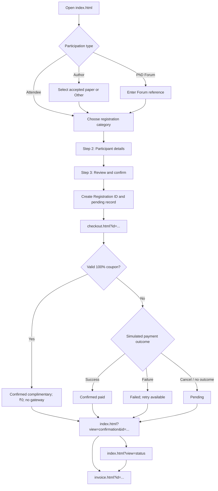

# AsianHOST 2026 — Registration Website

**Source code, local setup, registration workflow, and production implementation guide**

This repository is the reference implementation of the participant-facing registration website for **AsianHOST 2026**, taking place **11–13 December 2026** at **IIT Kharagpur Research Park, Rajarhat, Kolkata**. It shows the intended visual design and participant journey: selecting a registration category, associating an accepted paper, entering participant details, reviewing the fee, checking out, receiving a simulated confirmation, looking up registration status, and printing a demonstration invoice.

| Resource | Address |
|---|---|
| Registration website demo | https://siddy1992.github.io/asianhost-2026-registration-demo/ |
| GitHub source repository | https://github.com/Siddy1992/asianhost-2026-registration-demo |
| Conference website | https://www.asianhost.org/2026/ |
| IIT Kharagpur CEP programme ID | `IIT/CEP/CON/CON/2025-2026/CS/162` |

> **Read before deploying:** This is a **static demonstration**, not a functioning registration/payment service. Browser-local data and sample records simulate the backend. No real money is charged, no confirmation emails are delivered, no participant identity or eligibility is authenticated, and no official invoice is issued. A production launch requires a backend, persistent database, approved payment gateway, notification service, and finance/organizer approval of business rules. The printable invoice is explicitly a **demo preview, not a tax invoice or payment receipt**.

## 1. Installation and running the website

### 1.1 Run locally

The source consists of HTML, CSS, and vanilla JavaScript. There are **no package dependencies, build steps, npm commands, or environment variables** for the demonstration.

```bash
git clone https://github.com/Siddy1992/asianhost-2026-registration-demo.git
cd asianhost-2026-registration-demo
python3 -m http.server 8000
```

Open **http://localhost:8000/**. Stop the server with `Ctrl+C`. You can also serve the files with any static web server. A local HTTP server is recommended over opening `index.html` directly as a `file://` URL.

The checkout and invoice pages require a registration reference passed from the main website. Start at `index.html` rather than opening `checkout.html` or `invoice.html` directly.

### 1.2 Publish the demonstration on GitHub Pages

1. Commit the source files to the repository's `main` branch, preserving the folder structure in Section 2.
2. Go to **GitHub → Settings → Pages**.
3. Set **Source: Deploy from a branch**, **Branch: `main`**, **Folder: `/(root)`**.
4. Save and wait for the Pages deployment to finish.
5. Open the demonstration URL shown above. Subsequent commits to `main` update the hosted static site.

**GitHub Pages cannot act as the production backend.** It cannot securely store registration records, keep payment gateway secrets, process verified gateway webhooks, enforce server-side pricing, send transactional emails, or issue authorized invoices.

### 1.3 Reset the demonstration

The browser stores registration records under the `localStorage` key `asianhost2026_demo_registrations_inr_v2`. To start again, clear the site's browser storage or use a private browsing session. Data is **not shared across browsers, devices, or participants**. The fictional sample records described in Section 9 remain available even after clearing local storage.

## 2. Source files and responsibilities

All paths are relative to the repository root.

| File | Role | Developer notes |
|---|---|---|
| `index.html` | Main registration UI: category selection, paper details, participant form, review, confirmation, and status lookup | Defines screen sections and form element IDs used by `app.js` |
| `app.js` | Registration logic and state | Contains `PAPER_LIST`, `RATES`, early deadline, validation, record creation, sample registrations, confirmation and status rendering |
| `styles.css` | Registration and confirmation styling | Shared visual appearance of the main site |
| `checkout.html` | Checkout screen | Shows order summary, coupon field and simulated payment actions |
| `checkout.js` | Checkout state transitions | Validates sample coupon codes, records 100% waivers, simulates paid/failed outcomes and navigates to confirmation |
| `invoice.html` | Printable invoice-preview page | Displays the branded document layout and print control |
| `invoice.js` | Invoice-preview data and calculations | Reads the registration record, checks confirmed status, calculates fee/discount presentation, invokes browser printing |
| `invoice.css` | Invoice page styling | Includes screen styling and A4 print/PDF layout |
| `assets/asianhost-logo.png` | AsianHOST logo | Used in registration and invoice presentation |
| `assets/iitkgp-logo.png` | IIT Kharagpur logo | Used in registration and invoice presentation |
| `.nojekyll` | Static hosting helper | Allows GitHub Pages to serve files without Jekyll processing |
| `README.md` | Developer specification | Setup, screen transitions, fees, field rules, demo testing and production integration |

The HTML pages reference their respective CSS/JavaScript files using relative paths. Keep these names and paths intact unless you update their references consistently.

## 3. Page structure and navigation

The registration journey spans three HTML pages. The main page (`index.html`) contains multiple views and a three-step form; it does **not** use a separate HTML file for every form step.



**Important:** The invoice link is shown only for registrations marked `paid` in the demonstration. This includes complimentary registrations whose fee was waived. Failed and pending registrations do not receive an invoice-preview link.

| Screen / view | Where it lives | User action | Result |
|---|---|---|---|
| Registration Step 1 | `index.html`, `register` view | Choose purpose, paper, fee category and rate period | Step 2 after validation |
| Registration Step 2 | `index.html`, `register` view | Enter participant/billing information | Step 3 after validation |
| Registration Step 3 | `index.html`, `register` view | Review details and accept confirmation checkbox | Creates pending record and Registration ID; opens checkout |
| Checkout | `checkout.html?id=<registration-id>` | Apply valid waiver coupon | Fee becomes ₹0; registration confirmed; bank/payment screen skipped |
| Checkout | `checkout.html?id=<registration-id>` | Simulate success | Status becomes `paid`; confirmation view |
| Checkout | `checkout.html?id=<registration-id>` | Simulate failure | Status becomes `failed`; confirmation view; retry possible |
| Checkout | `checkout.html?id=<registration-id>` | Cancel/return | Remains pending unless previously resolved; confirmation view |
| Confirmation | `index.html?view=confirmation&id=<registration-id>` | View outcome; check status; optionally print preview | Status screen or invoice page |
| Status lookup | `index.html?view=status` | Supply ID and registered email | Shows matching record and available actions |
| Invoice preview | `invoice.html?id=<registration-id>` | Print / Save as PDF | Browser print dialog, optimized for A4 |

The URL examples describe the demonstration's current navigation. Production may use other routes if the same behavior is preserved.

## 4. Registration types and accepted-paper rules

### 4.1 Paper author

The author selects an accepted paper from the dropdown. The list is defined in `PAPER_LIST` in `app.js`; it is reference data, not a live connection to a paper-management system.

If the paper is absent, select **Other — my accepted paper is not listed**. Two fields appear:

- **Paper ID** — mandatory.
- **Paper Title** — mandatory.

The form cannot proceed until both are provided. The registration stores `paperSource: "manual"` and `paperVerification: "pending_organizer_review"`; the organizer must verify these details against accepted papers. Selecting an existing listed paper stores `paperSource: "listed"`.

At least **one full IEEE Member or Non-IEEE Member registration per accepted paper** is required. When an author checks the box indicating that their registration covers this mandatory requirement, the interface restricts fee selection to these two full categories. An author not covering the paper may select another eligible non-PhD category. Organizers must enforce paper coverage in the production database, including verification of manual entries and prevention of duplicate or incorrect coverage.

### 4.2 General attendee

General attendees choose an eligible non-PhD category. Student, Indian-only and IEEE eligibility checks apply according to the category selected.

### 4.3 PhD Forum

PhD Forum participants enter a submission/acceptance reference and choose the **PhD Forum – Indian** or **PhD Forum – International** fixed-fee category. These categories are not affected by the early-registration cutoff. The operational plan allows PhD Forum registration/payment on the poster-session day, subject to the actual on-site collection arrangements and committee confirmation.

## 5. Registration categories, fees and deadline

All amounts are denominated in **Indian rupees (INR)**.

| Category | Early registration | Regular/on-site | Conditions |
|---|---:|---:|---|
| IEEE Member | ₹50,000 | ₹60,000 | IEEE number; eligible for full-paper coverage |
| Non-IEEE Member | ₹60,000 | ₹70,000 | Eligible for full-paper coverage |
| IEEE Member – Student | ₹15,000 | ₹25,000 | IEEE number and student declaration |
| Non-IEEE Member – Student | ₹25,000 | ₹35,000 | Student declaration |
| IEEE Life Member | ₹25,000 | ₹35,000 | IEEE number/verification |
| General Participation – Indian Student | ₹2,000 fixed | ₹2,000 fixed | Indian participant and student declaration |
| PhD Forum – International | ₹15,000 fixed | ₹15,000 fixed | PhD Forum reference |
| PhD Forum – Indian | ₹5,000 fixed | ₹5,000 fixed | Indian participant and PhD Forum reference |

**Early-registration cutoff:** **15 November 2026 at 23:59:59 IST**. From **16 November 2026 at 00:00:00 IST**, the interface disables early pricing and selects regular/on-site pricing for time-dependent categories. Fixed-fee categories remain unchanged.

`app.js` uses `REGULAR_START_MS = Date.parse('2026-11-16T00:00:00+05:30')`, checks the browser clock, and rechecks when the tab regains focus and before checkout. **The production server must independently calculate the correct price and reject expired early-rate orders**, regardless of browser clock or cached page state.

**Supplementary category correction:** An IEEE Member registration that must be corrected to Non-IEEE Member may require an organizer-authorized **₹10,000** balance payment. The demonstration exposes a preview action on an eligible confirmed IEEE registration and creates a separate `kind: "balance"` order. This is **not a ninth public registration category**. In production, only authorized organizers should create such orders, and the amount/policy must be verified before collection.

## 6. Participant information and review

| Field | Requirement | How it is used |
|---|---|---|
| Full name | Required | Registration identity and confirmation |
| Email address | Required | Status lookup and intended notification recipient |
| Phone | Required | Participant contact; include country code |
| Institution/organization | Required | Affiliation and invoice preview |
| Country and city | Required | Address and Indian-category eligibility |
| IEEE membership number | Conditional | Required for IEEE categories; format checked in demo, actual membership verified by organizer |
| Student declaration | Conditional | Required for student categories; enrollment evidence checked in production |
| Paper ID/title | Conditional | Author paper selection or Other-paper entry |
| PhD Forum reference | Conditional | PhD Forum participation |
| Visa/invitation assistance | Optional | International participants |
| Billing name and GSTIN | Optional | Displayed in invoice preview; GSTIN is not authenticated |

`app.js` performs form validation, selects eligible categories and builds the review summary. The review screen shows participation type, category, paper association where applicable, participant details and the current fee. The participant must confirm the details before checkout.

**Production:** Validate all fields on the server, confirm IEEE/student eligibility and any Indian-only restrictions, and avoid treating user-entered paper IDs or GSTINs as verified.

## 7. Registration ID and browser-local data

After the participant confirms the review screen, `app.js` creates a record with an automatically generated `AH26-` registration reference, initial `status: "pending"`, and the chosen fee. The reference is generated client-side for demonstration and saved to browser `localStorage`.

A typical stored record has this shape (illustrative; optional fields vary by registration type):

```json
{
  "id": "AH26-EXAMPLE01",
  "kind": "registration",
  "purpose": "author",
  "period": "early",
  "category": "ieee",
  "categoryName": "IEEE Member",
  "currency": "INR",
  "amount": 50000,
  "paperId": "5",
  "paperTitle": "Example accepted paper",
  "paperSource": "listed",
  "coversPaper": true,
  "person": {"name": "Example Registrant", "email": "example@example.org"},
  "status": "pending"
}
```

The shared storage key is **`asianhost2026_demo_registrations_inr_v2`** in `app.js`, `checkout.js`, and `invoice.js`. Checkout changes `status`, `amount` and any coupon fields in the same record; the confirmation and invoice pages then read that record. A successful complimentary registration is represented by `status: "paid"` together with `paymentMethod: "complimentary_coupon"`, `amount: 0`, and the coupon/discount fields. Here `paid` means *confirmed in the demo*; no funds are transferred for a waiver.

**Production:** Generate a unique ID on the backend with a database uniqueness constraint (e.g. `AH26-000123`). Keep the same registration ID for retries and associate distinct payment attempt IDs. Do not use browser-local data as the authoritative registration database. Keep public registration references distinct from payment-provider transaction identifiers.

## 8. Checkout, coupons and payment state

`checkout.html` reads the order from the `id` URL parameter. `checkout.js` looks it up in local storage and displays the participant, category and payable INR amount. If no order exists, the payment controls are disabled.

### Coupon codes used by the demonstration

| Code | Discount | Result |
|---|---:|---|
| `AH26-WAIVER-100` | 100% | Complimentary confirmed registration; ₹0 payable |
| `ASIANHOST-GUEST` | 100% | Complimentary confirmed registration; ₹0 payable |
| `PHD26-FREE` | 100% | Complimentary confirmed registration; ₹0 payable |

The codes are intentionally public in `checkout.js` for testing. They work for normal registration categories in this demonstration; the code labels do not restrict them to a particular category. **They do not apply to `kind: "balance"` orders.**

When a valid coupon is applied, the browser stores the original fee, discount, code and final amount of ₹0; marks the registration confirmed; and goes straight to the confirmation screen. **There is no gateway redirect or payment attempt.** Invalid coupons display an error and leave the normal simulated payment path available.

The checkout page also offers simulated **successful**, **failed**, and **cancel/return** actions. A successful simulated payment marks the order `paid`; failure marks it `failed`; cancellation leaves it pending. These buttons **do not charge a card**.

| Registration state | Meaning in the demonstration | Participant action |
|---|---|---|
| `pending` | Registration exists; payment not confirmed | Check status or return to checkout |
| `paid` (normal) | Simulated payment success | View confirmation/status/invoice preview |
| `paid` + `complimentary_coupon` | Approved 100% waiver in demo | View confirmation/status/invoice preview; no bank step |
| `failed` | Simulated payment failure | Retry checkout or check status |

**Production:** Coupons must be verified and redeemed server-side, with expiry, scope, usage limits, organizer authorization, atomic redemption and audit logs. Public JavaScript must never be the source of valid real coupons. For a nonzero amount, create a payment-provider order on the server and verify the provider's signed webhook/callback, order reference, amount and currency before confirming payment. Handle duplicate callbacks idempotently and reconcile pending payments. A confirmed ₹0 waiver must skip payment-order creation.

## 9. Confirmation, status lookup and sample records

The confirmation view is rendered by `app.js` at `index.html?view=confirmation&id=...`. It displays the registration reference, participant, category, amount, coupon information where applicable, and the appropriate successful/failed/pending message.

The **Check Status** view accepts the **Registration ID and registered email address**. The lookup uses the fictional built-in records and same-browser local registrations. It does not query a remote server. For a confirmed registration, the status view offers an invoice-preview link; for an eligible confirmed IEEE Member record, it may also show the supplementary-balance demonstration action.

| Sample Registration ID | Sample email | Simulated status |
|---|---|---|
| `AH26-SAMPLE-0001` | `avery@example.org` | Successful |
| `AH26-SAMPLE-0002` | `jordan@example.org` | Failed |
| `AH26-SAMPLE-0003` | `sam@example.org` | Pending |

The sample records are defined in `app.js`; the paid sample is also available to `invoice.js` for a printable example.

**Production:** Store and query registrations in a shared database. Use rate limiting, generic no-match responses, and appropriate email verification/OTP or authenticated access to protect participant information. A registration reference alone must not expose private data.

## 10. Invoice preview and print/PDF behavior

The invoice screen is implemented by `invoice.html`, `invoice.js`, and `invoice.css`.

1. Complete a registration with a simulated successful payment **or** apply a valid 100% coupon; alternatively use the successful sample record from Section 9.
2. On confirmation or status, choose **View / print demo invoice**.
3. The site opens `invoice.html?id=<registration-id>`.
4. `invoice.js` reads the registration record, requires `status: "paid"` and INR currency, and renders the document.
5. Click **Print / Save as PDF** and choose the browser's PDF destination. `invoice.css` provides A4 print styling.

The document includes the AsianHOST/IIT Kharagpur logos, participant/billing details, unverified participant-provided GSTIN (if present), registration ID, an illustrative `DEMO-INV-<registration-id>` reference, category, fee, discount, and final INR amount. Complimentary registrations display a **100% discount and ₹0**. An eligible paid registration with a completed supplementary balance order can show the ₹10,000 correction line.

The page refuses to render an invoice preview if the registration is absent, pending, failed, a standalone balance order, or not denominated in INR. It is explicitly labeled **“DEMO INVOICE PREVIEW — NOT A TAX INVOICE.”** The issuer details are illustrative; no GST, statutory invoice number, tax-inclusive/exclusive determination, or legal receipt is generated. Browser-local data is not proof of payment.

**Official invoices:** The intended participant-facing notice is that an official invoice, where applicable, is available **upon request at a later date**. The organizing/CEP finance team must confirm the authorized issuer, address, GSTIN, place-of-supply/tax treatment, numbering, billing details, issuance rules and any applicable treatment of complimentary registrations. If official invoices are issued, generate and record them only through an approved, server-side finance workflow after verifying payment or organizer-approved waiver. The demonstration preview must not be represented as an official invoice.

## 11. Email notifications and organizer administration

The demonstration displays the expected notification messages but **does not send email**. The production system should send status-dependent messages to the participant's registered email after a trusted backend state transition.

| Event | Example subject | Contents |
|---|---|---|
| Verified paid registration | `AsianHOST 2026 — Registration Payment Successful — [ID]` | Registration ID, participant, category, amount, payment reference, status link |
| Complimentary waiver | `AsianHOST 2026 — Complimentary Registration Confirmed — [ID]` | Registration ID, category, original fee, discount, ₹0 payable, status link |
| Failed payment | `AsianHOST 2026 — Registration Payment Unsuccessful — [ID]` | Registration ID, failure status, retry/status link |
| Pending payment | `AsianHOST 2026 — Registration Payment Pending — [ID]` | Registration ID, pending status, status link |

An organizer-facing backend should support maintaining the accepted-paper list, checking manual paper entries, verifying IEEE membership/student eligibility, approving fee waivers, managing coupon limits, creating authorized supplementary payment requests, reconciling gateway transactions, monitoring email delivery, and handling invoice requests. None of these organizer operations is securely implemented by the static demonstration.

## 12. Production implementation map

Keep the demonstrated screens and overall participant journey while replacing browser-only state with trusted services.

| Component | Demonstration source | Production responsibility |
|---|---|---|
| Paper list and author eligibility | `app.js`: `PAPER_LIST`, `allowedRates()`, `validateStep1()` | Accepted-paper database; paper coverage validation; manual-entry review |
| Fee and cutoff | `app.js`: `RATES`, `REGULAR_START_MS`, `currentAmount()` | Authoritative INR fee calculation and IST cutoff on server |
| Participant form | `index.html`, `app.js`: `validateStep2()`, `collectPerson()` | Server validation, persistence, eligibility verification |
| Registration ID | `app.js`: `createId()`, `registerOrder()` | Database-generated unique reference, stable across retries |
| Coupon redemption | `checkout.js`: `SAMPLE_COUPONS` | Secure coupon registry, authorization, limits and atomic redemption |
| Payment | `checkout.html`, `checkout.js` | Approved gateway order creation, hosted checkout, verified webhook, reconciliation |
| Confirmation/status | `app.js`: `renderConfirmationFromQuery()`, `showStatus()` | Authenticated status API and protected participant data |
| Invoice preview | `invoice.html`, `invoice.js`, `invoice.css` | Finance-approved invoice/receipt policy, authorized document issuance and audit trail |
| Email notifications | Text in `app.js` | Transactional email provider, templates, retries and delivery logs |

A possible backend API shape (for discussion; **these endpoints do not exist in the static source**) is:

```text
POST /api/registration/quote                 -> eligible category and server-calculated fee
POST /api/registrations                     -> validate/create registration and ID
POST /api/registrations/{id}/coupon         -> validate/redeem coupon; confirm ₹0 waiver
POST /api/registrations/{id}/payment        -> create positive-amount gateway order
POST /api/payments/webhook                  -> verify provider event and update payment state
POST /api/registrations/status              -> secure registration status lookup
POST /api/admin/registrations/{id}/balance  -> authorized supplementary payment
POST /api/admin/invoices                    -> finance-authorized invoice workflow, if approved
```

Store at least participant, registration, paper association, fee quote, coupon/redemption, payment order and attempts, state history, email notifications, invoice request/issuance state, and organizer audit data. Use HTTPS, secrets management, least-privilege access, backups, monitoring, and payment-provider reconciliation. **Do not store card details on the conference server.**

## 13. End-to-end developer test cases

Test the demonstration locally and then repeat equivalent cases against the production staging system.

| Test | Expected result |
|---|---|
| Select a listed accepted paper | Paper ID/title appear in review and registration record |
| Select **Other** without Paper ID or Title | Continue is blocked with a validation message |
| Enter Other Paper ID and Title | Form proceeds; details retained; organizer review flagged |
| Cover a paper's mandatory full registration | Only IEEE Member or Non-IEEE Member fee choices |
| Choose a student or Indian-only category | Appropriate declarations/eligibility checks apply |
| Use early fee before 16 Nov 2026 IST | Early fee displayed for time-dependent categories |
| Use registration after cutoff | Early choice disabled; regular fee applied; fixed categories unchanged |
| Complete review | Unique-looking demo ID and pending record created |
| Apply `AH26-WAIVER-100` | ₹0 payable, complimentary confirmation, no gateway |
| Apply `ASIANHOST-GUEST` or `PHD26-FREE` | Same 100% waiver behavior |
| Apply invalid coupon | Error shown; amount unchanged; payment actions available |
| Simulate payment success | Confirmation, status and printable invoice preview available |
| Simulate payment failure | Failure status and retry; invoice preview unavailable |
| Cancel without paying | Pending status; invoice preview unavailable |
| Look up `AH26-SAMPLE-0001` + `avery@example.org` | Successful sample shown; invoice preview accessible |
| Look up `AH26-SAMPLE-0002` or `AH26-SAMPLE-0003` | Failed/pending sample shown; no invoice preview |
| Print confirmed invoice preview | A4 printable layout; clearly marked NOT A TAX INVOICE |
| Attempt invoice URL for failed/pending record | Unavailable message, no printable invoice |
| Create eligible ₹10,000 balance payment | Separate supplementary order; dummy waiver not accepted |
| Clear browser storage | Created demo registrations disappear; built-in samples remain |
| Production: change device clock or tamper with fee | Server refuses incorrect/expired price |
| Production: repeat coupon/webhook requests | No duplicate redemption, charge or confirmation |
| Production: verify paid status and email | Success only after signed gateway verification; email delivery logged |

## 14. Developer handoff and deployment readiness

1. Run the repository locally and examine all three HTML pages and their corresponding scripts.
2. Walk through author, attendee and PhD Forum registrations using the fee schedule and validation rules above.
3. Exercise paid, complimentary, failed and pending outcomes, status lookup, invoice preview and the supplementary-payment case.
4. Implement the backend and connect the existing frontend to trusted registration, coupon, payment, status and email services.
5. Obtain organizing-committee and IIT Kharagpur finance/CEP confirmation for official invoices, taxes, issuer details, supplementary payments and production coupon authorization.
6. Deploy a separate HTTPS staging environment for end-to-end testing, including **international card acceptance**, payment reconciliation, email delivery and waiver handling.
7. Launch only after confirming the live gateway, server-side deadline/fee enforcement, eligibility checks, secure status lookup, and operational support arrangements.

**Expected end state:** A participant can complete registration, pay the correct INR amount or redeem an authorized complimentary waiver, receive a unique Registration ID and confirmation, check their registration status, and request any official invoice through the approved finance process.
