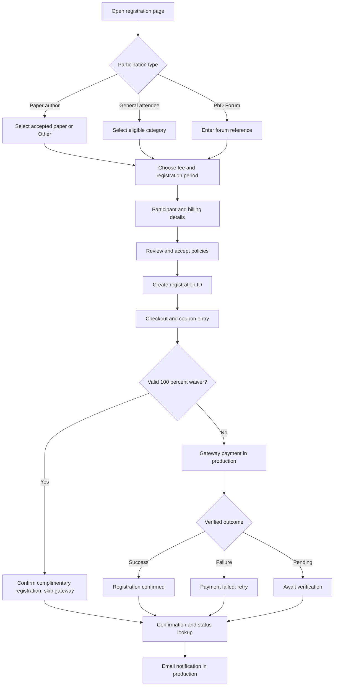

# AsianHOST 2026 — Registration Website

**Source code, local setup, complete registration workflow, fee schedule, coupons, policies, status lookup, sample invoice design, and production implementation guide**

This is the reference website for **AsianHOST 2026 — 11th Asian Hardware Oriented Security and Trust Symposium**, hosted by **Indian Institute of Technology Kharagpur** on **11–13 December 2026** at **IIT Kharagpur Research Park, Rajarhat, Kolkata, India**. It is intended to communicate the complete participant journey to the registration-site developers and payment-gateway integrator. It retains the earlier author, attendee, PhD Forum, coupon, status, category-correction and illustrative invoice features, while adding the four mandatory policy pages.

| Resource | Address / reference |
|---|---|
| Public conference website | https://www.asianhost.org/2026/ |
| Existing GitHub Pages demonstration | https://siddy1992.github.io/asianhost-2026-registration-demo/ |
| Source repository | https://github.com/Siddy1992/asianhost-2026-registration-demo |
| IIT Kharagpur CEP programme | `IIT/CEP/CON/CON/2025-2026/CS/162` |
| Registration currency | INR (Indian rupees) |
| Early registration deadline | **15 November 2026, 11:59 p.m. IST** |
| Regular / on-site fees begin | **16 November 2026, 12:00 a.m. IST** |
| PhD Forum fees | Fixed, not subject to the early/regular deadline |
| Refund request deadline | **5 December 2026, 11:59 p.m. IST** |

> **Critical deployment distinction:** This is a **static, browser-only demonstration**, not a live payment service. Sample coupon codes are publicly visible and must not be used as real authorization. The simulated checkout **does not collect funds**, browser-local records are not a real database, no notification emails are sent, and the invoice screen is an illustrative **SAMPLE / NOT AN OFFICIAL INVOICE**. The live vendor must replace these components with authenticated backend services and a verified payment gateway before accepting registrations. Do not ask participants to enter genuine payment card details in this demonstration.

## 1. Installation and running the website

### 1.1 Run locally

This implementation uses HTML, CSS and vanilla JavaScript; it has no npm dependencies or build step. From the extracted website directory:

```bash
python3 -m http.server 8000
```

Open `http://localhost:8000/` in a browser. You can also open the static files locally, but using an HTTP server is more reliable for navigation and testing. Press `Ctrl+C` to stop the server.

### 1.2 Publish the demonstration on GitHub Pages

1. Upload `index.html`, `app.js`, `checkout.html`, `checkout.js`, `styles.css`, `terms.html`, `refund.html`, `privacy.html`, `about-contact.html`, `policy.css`, `invoice.html`, `invoice.js`, `invoice.css`, `.nojekyll`, and the entire `assets/` directory to the repository root.
2. Commit to the `main` branch.
3. Open **Settings → Pages** and select **Deploy from a branch → main → /(root)**.
4. Wait for the Pages deployment to complete, then open the URL shown above.
5. When deploying an update, upload the entire set of changed files together; do not mix an older `app.js` or `checkout.js` with a newer `index.html`.

`developer_tools/` is **not required on the public website**. It contains a local coupon-generation script, not participant-facing code. Do **not** publish any CSV of genuine coupon codes.

### 1.3 Reset the demonstration

Records created by the demo are stored in the current browser's `localStorage` under the key:

```text
asianhost2026_demo_registrations_inr_v2
```

To start fresh, clear storage for the website or use a private browsing window. Data is not synchronized across browsers, computers or participants. The three fictional sample records remain available because they are defined in `app.js`.

## 2. Source files and responsibilities

| File | Purpose | Notes for production developer |
|---|---|---|
| `index.html` | Registration form, review, confirmation, status lookup | Main participant-facing page |
| `app.js` | Fee table, deadline, paper rules, form validation, local records, confirmation and status | Replace browser-only operations with trusted APIs |
| `styles.css` | Shared responsive styling | Preserve branding, mobile layout and accessible states |
| `checkout.html` | Checkout, coupon input and simulated payment outcome | Replace payment buttons with hosted gateway checkout |
| `checkout.js` | Sample 100% coupons, waived confirmation, mock paid/failed outcomes | Never trust client-side coupon or payment decisions |
| `invoice.html` | **Illustrative invoice design, linked from confirmed status and confirmation** | Do not issue this as an official receipt or tax invoice |
| `invoice.js` | Loads a successful sample/browser registration and populates the illustrative layout | Replace with approved server-generated invoice on request |
| `invoice.css` | Printable invoice-preview design | Includes visible SAMPLE watermark |
| `terms.html` | Terms & Conditions | Review with organizers before live release |
| `refund.html` | Refund & Cancellation | Contact: Prof. Sarani Bhattacharya; cutoff 5 Dec |
| `privacy.html` | Privacy Policy | Finalize with hosting, retention and gateway arrangements |
| `about-contact.html` | About Us & Contact Us | Participant-facing conference and contact details |
| `policy.css` | Shared policy-page styling | Uses existing conference header and logos |
| `assets/` | AsianHOST and IIT Kharagpur logos | Preserve file paths |
| `developer_tools/generate_coupons.py` | Generates unique coupon codes in a private CSV | Run locally; do not deploy real coupon registry to GitHub Pages |
| `.nojekyll` | GitHub Pages deployment compatibility | Can remain empty |

## 3. Page structure and navigation

The main registration page uses three steps: **(1) registration type, accepted paper and category; (2) participant details; (3) review and acknowledgement**. The participant then proceeds to checkout. The status and confirmation screens are separate views within `index.html`.



**URLs and views:** `index.html` opens the form; `index.html?view=status` opens status lookup; `index.html?view=confirmation&id=<registration-id>` shows an outcome; `checkout.html?id=<registration-id>` opens checkout. `invoice.html?id=<registration-id>` is linked by **View / Print Invoice Preview** buttons for confirmed (paid or complimentary) demo registrations; it is an illustrative design reference, not an official participant invoice. Policy pages are linked from the website footer and review acknowledgement.

## 4. Registration types and accepted-paper rules

### 4.1 Paper author

Authors choose their accepted paper from the list in `app.js` (`PAPER_LIST`). The 12 entries currently in that list are reference data, not an API connection to the conference submission platform. If the accepted paper is absent, the restored **Other — my accepted paper is not listed** option displays two mandatory fields: **Paper ID** and **Paper Title**. Both are recorded for organizer verification.

**At least one full registration must cover every accepted main-conference paper.** Only **IEEE Member** and **Non-IEEE Member** full registration categories qualify. IEEE Student, Non-IEEE Student, IEEE Life Member, general participation and PhD Forum categories do not satisfy this paper-coverage requirement. If an author is registering without providing mandatory coverage because another eligible full registration already covers the paper, the organizers must verify the link before accepting the paper as covered.

The browser enforces the category filter for the chosen coverage option, but the production backend must enforce it against the accepted-paper database, multiple authors, payment status, cancellation, and substitution. A typed **Other** paper must not be treated as accepted without organizer verification.

### 4.2 General attendee

General attendees select an available non-PhD category. Student categories require an enrollment declaration and eventual verification. Indian-only rates require Indian eligibility. IEEE Member and IEEE Life Member categories collect an IEEE membership number; an organizer validates it. A user entering a number is **not** proof of IEEE eligibility.

### 4.3 PhD Forum

PhD Forum participants enter their submission/acceptance reference and choose a fixed-fee **Indian** or **International** category. The PhD Forum fee is **not** subject to the early/regular registration cutoff. The organizing plan permits registration/payment on the poster-session day, subject to the approved on-site payment arrangements. Participation, reference validity and student eligibility must be verified by the organizers. A PhD Forum registration does not cover an accepted main-conference paper.

## 5. Registration categories, INR fees and deadlines

| Category | Early (through 15 Nov) | Regular / on-site (from 16 Nov) | Eligibility |
|---|---:|---:|---|
| IEEE Member | ₹50,000 | ₹60,000 | Full-paper coverage; IEEE verification |
| Non-IEEE Member | ₹60,000 | ₹70,000 | Full-paper coverage |
| IEEE Member – Student | ₹15,000 | ₹25,000 | Student + IEEE verification |
| Non-IEEE Member – Student | ₹25,000 | ₹35,000 | Student verification |
| IEEE Life Member | ₹25,000 | ₹35,000 | IEEE Life Member verification |
| General Participation – Indian Student | ₹2,000 | ₹2,000 | Fixed fee; Indian student only |
| PhD Forum – International | ₹15,000 | ₹15,000 | Fixed fee; forum eligibility |
| PhD Forum – Indian | ₹5,000 | ₹5,000 | Fixed fee; forum eligibility |

**Cutoff:** Early registration is open through **15 November 2026, 11:59 p.m. IST**. At **16 November 2026, 12:00 a.m. IST**, the Early option is disabled and Regular / On-site is automatically selected. The frontend rechecks the deadline on returning to a background tab, before creating an order, and when opening an unpaid early-fee checkout. Fixed-fee categories are unchanged.

**Important:** JavaScript uses the participant's local device clock, which can be manipulated. In production, enforce the deadline and price with the server's trusted timestamp and an immutable fee quote/order. A pending early order cannot be paid at an expired rate after the cutoff unless explicitly authorized by the conference. Display the revised amount before collecting funds.

**International payments:** INR is the base fee currency. If the payment gateway supports international cards and Dynamic Currency Conversion (DCC), a cardholder may see a local-currency quote, depending on the gateway/bank setup and card issuer. Confirm the applied FX rate, conversion charges, merchant discount rate, taxes, settlement currency, and who bears each charge with the gateway. Do not promise a particular FX rate or zero international transaction charges.

## 6. Participant information and review

| Field | Requirement | Use |
|---|---|---|
| Full name | Required | Participant identity, confirmation |
| Registered email | Required | Status lookup, transaction notifications |
| Mobile number | Required | Contact and clarification |
| Institution / affiliation | Required | Participant record |
| Country and city | Required | Eligibility and contact |
| IEEE membership number | Conditional | Organizer verification |
| Student declaration | Conditional | Student-rate eligibility |
| Accepted Paper ID / Title | For author | Paper association and coverage |
| PhD Forum reference | For PhD Forum | Submission/acceptance verification |
| Visa assistance request | Optional | Organizing committee follow-up |
| Invoice/billing name | Optional | Later invoice request |
| GSTIN | Optional | Later Indian invoice request; must be verified |

The final review screen displays registration purpose, category, fee period, accepted-paper details (including manually entered **Other**), coverage declaration, participant details, and payable amount. The participant must acknowledge the **Terms & Conditions**, **Refund & Cancellation**, and **Privacy Policy** before checkout.

**Privacy/security:** The sample browser form is not appropriate for live passport collection or card-data entry. Do not place actual passport scans, payment details, private coupon registries, or participant exports in a public repository.

## 7. Registration ID and browser-local data

After review, `app.js` generates a sample `AH26-...` registration reference and saves a pending record in browser `localStorage`. In production, IDs must be generated and reserved by the backend, be unique across participants and payment attempts, and be bound to a verified email address.

Illustrative record shape:

```json
{
  "id": "AH26-EXAMPLE123",
  "kind": "registration",
  "purpose": "author",
  "period": "regular",
  "category": "ieee",
  "categoryName": "IEEE Member",
  "currency": "INR",
  "amount": 60000,
  "paperId": "18",
  "paperTitle": "Example accepted paper title",
  "coversPaper": true,
  "person": {
    "name": "Example Participant",
    "email": "participant@example.org",
    "institution": "Example Institution",
    "country": "India"
  },
  "status": "pending",
  "created": "2026-11-03T09:00:00Z"
}
```

For a complimentary registration, the demo adds `originalAmount`, `discountAmount`, `couponCode`, `paymentMethod: "complimentary_coupon"`, `paymentGatewaySkipped: true`, `amount: 0`, and `status: "paid"`. The status value `paid` means *confirmed in the demo*, not that money was transferred. A production system should use an explicit **confirmed complimentary** state to avoid confusing fee waivers with collected revenue.

## 8. Checkout, coupon codes and payment states

`checkout.html` reads the `id` query parameter, looks up the record, and shows registrant, category and INR amount. An unknown reference disables payment controls. The simulated payment buttons allow developers to inspect successful and failed transactions; they must be replaced by the payment gateway's actual hosted checkout or supported SDK.

### 8.1 Restored coupon entry and 100% waiver

The checkout page again includes a **Discount / complimentary registration coupon** field and an **Apply coupon** button. Three deliberately public sample codes are built into `checkout.js` for UI testing:

| Example code | Demo effect |
|---|---|
| `AH26-WAIVER-100` | 100% registration fee waiver |
| `ASIANHOST-GUEST` | 100% invited-participant waiver |
| `PHD26-FREE` | 100% PhD Forum waiver |

A valid sample code changes the original amount to a **₹0 payable balance**, records the discount, marks the registration as confirmed, and navigates directly to the confirmation screen. **The gateway is skipped completely.** Invalid codes show an error without changing the payable amount. The supplementary ₹10,000 category-correction payment is excluded from the sample waiver flow.

The sample codes are reusable by design for a static demo; **they are not genuine production coupon codes**. The organizer must approve any real discount and upload/maintain coupons in a private database. Validate scope (category/paper/participant), expiry, redemption limit, discount amount and eligibility server-side; redeem atomically to prevent double use. A successful zero-fee registration should create a confirmed complimentary record and send an email without opening a bank page.

### 8.2 Generate at least 150 unique private coupon codes

A standalone Python generator is included at `developer_tools/generate_coupons.py`. Run it privately:

```bash
python3 developer_tools/generate_coupons.py --count 150 --prefix AH26 --output coupons_private.csv
```

It uses random generation and checks for duplicates. The CSV is for organizer/backend import **only**. Do not publish generated authorized codes in GitHub Pages, frontend JavaScript, a public repository, or a public status endpoint. Actual coupon validity is determined exclusively by the production backend.

### 8.3 Transaction outcomes

| State | Participant-facing result | Production trigger |
|---|---|---|
| `pending` | Awaiting payment confirmation; check status | Order created or gateway pending |
| `paid` | Successful payment confirmation | Verified gateway callback / reconciliation |
| `failed` | Payment unsuccessful; retry option | Verified failure/cancellation outcome |
| `paid` + `complimentary_coupon` | Confirmed complimentary registration; ₹0 due | Authorized 100% server-side coupon redemption |

A browser redirect alone is not evidence of payment. Verify gateway signature/webhook, order ID, amount, currency, and merchant account before marking paid. Treat repeated callbacks idempotently, reconcile pending transactions, and avoid duplicate confirmation emails.

### 8.4 Supplementary balance payment

The earlier ₹10,000 **Other – Balance Payment** demonstration remains available to illustrate an IEEE Member registration that requires correction to the Non-IEEE Member category. In the demo, a confirmed IEEE Member record can create a linked `AH26-BAL-...` order for ₹10,000; successful completion marks the parent record as corrected. **Production:** the organizing committee must first authorize the balance payment. Never expose an unrestricted user-created supplemental charge; verify the shortfall, reference and payment status on the server.

## 9. Confirmation, status lookup and sample records

After a simulated success, failure, pending result, or complimentary coupon, the participant sees a confirmation screen containing the registration ID, name, category, amount, email and relevant outcome. A complimentary registration is labeled **Registration confirmed — fee waived** rather than **Payment successful**. Invoice-on-request language remains visible. For confirmed registrations, the confirmation screen now shows a **View / Print Invoice Preview** button and an email-based **Request Official Invoice** action (not shown for fictional sample records). Failed or pending registrations do not show invoice actions.

The **Check Status** view accepts **Registration ID + registered email address**. The following fictional records are always available:

| Registration ID | Email | Expected status |
|---|---|---|
| `AH26-SAMPLE-0001` | `avery@example.org` | Successful |
| `AH26-SAMPLE-0002` | `jordan@example.org` | Failed |
| `AH26-SAMPLE-0003` | `sam@example.org` | Pending |

A registration created in the same browser is also searchable. The status lookup is **not** a shared database and cannot retrieve another person's registration from a different device. In production, use a backend lookup with suitable identity verification and rate limiting; do not return personal data based solely on a guessable registration ID. Use generic failure messages to avoid account enumeration.

## 10. Illustrative invoice preview and print/PDF behavior

The illustrative invoice-design capability is implemented by `invoice.html`, `invoice.js`, and `invoice.css`. **This release restores the missing participant-facing buttons.** After a simulated successful payment or a 100% complimentary coupon, the participant can open the invoice design from either:

1. **Payment confirmation:** **View / Print Invoice Preview** appears alongside **Check registration status**. For browser-created registrations, **Request Official Invoice** opens a pre-addressed email to `siddhartha.chowdhury92@gmail.com` containing the registration reference.
2. **Check registration status:** after entering the correct registration ID and registered email, confirmed results show **View / Print Invoice Preview** and (for non-sample records) **Request Official Invoice**. Failed and pending results intentionally do not offer an invoice preview.
3. **Invoice preview:** `invoice.html?id=<registration-id>` shows the sample invoice layout and a working **Print / Save as PDF** button. To test immediately, open `index.html?view=status`, select sample record `AH26-SAMPLE-0001`, and click **View / Print Invoice Preview**.

The preview includes participant/billing details, category, original amount, any coupon discount, and final amount. It has a prominent **SAMPLE — NOT AN OFFICIAL INVOICE** watermark. **The sample preview is not an official invoice, receipt, proof of payment or tax document.** The separate committee policy remains unchanged: an official invoice will be provided **upon request at a later date**. The email link is only an illustration of the request workflow; the static demo cannot send emails itself.

The production developer must issue official invoices through a controlled server-side process, never from unverified browser-local records.

In production, invoice generation must use verified settlement and registration data, approved issuer information, applicable tax/GST treatment, serial numbering, reconciliation, audit trail and an organizer-approved request workflow. Whether a zero-fee complimentary registration receives a separate acknowledgment or a zero-value invoice must be decided by IIT Kharagpur's authorized finance team.

## 11. Email notifications and organizer administration

The static site **does not send emails**. The production backend must send the appropriate message to the participant's registered email after a trusted state transition:

| Event | Suggested subject | Key content |
|---|---|---|
| Verified payment success | `AsianHOST 2026 — Registration Payment Successful — [ID]` | Name, registration ID, category, amount paid, transaction reference, dates, status URL |
| Payment failure | `AsianHOST 2026 — Registration Payment Unsuccessful — [ID]` | ID, attempted amount, retry/status instructions, support contact |
| Complimentary confirmation | `AsianHOST 2026 — Complimentary Registration Confirmed — [ID]` | ID, category, 100% fee waiver, ₹0 due, no gateway payment |
| Pending payment | `AsianHOST 2026 — Payment Status Pending — [ID]` | ID, status URL, advice not to repay until verified |
| Balance payment success | `AsianHOST 2026 — Additional Payment Received — [ID]` | Parent ID, corrected category, ₹10,000 payment reference |

**Invoice statement for participant-facing emails:** “An invoice will be provided upon request at a later date.” Do not automatically attach a demo invoice.

The production system should log send attempts, failures, delivery status and deduplicate event-triggered messages. An organizer-only administration interface should allow authorized staff to verify IEEE/student eligibility, inspect paper coverage, approve coupons and waivers, reconcile payments, handle refunds/substitutions, and respond to invoice requests. None of these privileged functions belongs in public browser JavaScript.

## 12. Production implementation map

| Demonstration component | Production replacement / requirement |
|---|---|
| `PAPER_LIST` | Authoritative accepted-paper dataset and manual exception review |
| `RATES`, `currentAmount()` | Server-side INR fee schedule and signed/locked quotes |
| `isEarlyRegistrationOpen()` | Trusted server clock in IST; cutoff at 16 Nov 00:00 |
| `localStorage` records | Persistent database with unique registration IDs and transaction history |
| `SAMPLE_COUPONS` | Private coupon registry, organizer authorization, expiry, limits, atomic redemption |
| Mock payment buttons | Approved hosted gateway checkout, international cards, DCC if enabled |
| Browser status | Authenticated backend status lookup, rate limits, privacy safeguards |
| Confirmation screen | Verified server registration state |
| Email notice text | Transactional email service with retries and delivery logs |
| `invoice.html` | Approved invoice-on-request workflow and legally compliant document generation |
| Refund request email | Organizer review workflow with deadline and audit record |
| Privacy and terms pages | Approved, maintained public policies linked from every relevant screen |

Suggested conceptual API (illustrative, not implemented):

```text
GET    /api/fees
GET    /api/papers
POST   /api/registrations
GET    /api/registrations/{id}/status    [verified requester]
POST   /api/registrations/{id}/coupon    [server-side validation]
POST   /api/registrations/{id}/payment-order
POST   /api/payment-provider/webhook      [signature verification]
POST   /api/registrations/{id}/balance   [organizer authorized]
POST   /api/registrations/{id}/invoice-request
POST   /api/registrations/{id}/refund-request
```

Minimum database concepts: `participants`, `registrations`, `accepted_papers`, `paper_coverage`, `fee_quotes`, `payment_orders`, `payment_attempts`, `coupon_definitions`, `coupon_redemptions`, `notifications`, `refund_requests`, `invoice_requests`, and `audit_events`. Store gateway secrets on the server, never in frontend code. Use HTTPS, least privilege, backups, access logging and an appropriate data-retention schedule. Do not store card numbers or CVVs.

**Payment gateway / DCC acceptance checklist:** Confirm domestic and international card acceptance, INR merchant settlement into the designated IIT Kharagpur account, checkout currencies, conversion rates, participant-borne versus merchant-borne fees, gateway MDR and taxes, payment callback signing, order idempotency, refund API support, and end-to-end test transactions with the provider.

## 13. End-to-end developer test cases

Run these against the static demo and repeat the equivalent cases on the production staging system:

| Scenario | Expected result |
|---|---|
| Choose listed accepted paper | Paper ID/title recorded and displayed in review |
| Choose **Other** without ID/title | Continue blocked until both are entered |
| Enter Other Paper ID/title | Details preserved in review, record and status |
| Paper author covers a paper | Only IEEE Member or Non-IEEE Member full category is available |
| Paper author not covering a paper | Other eligible categories selectable; organizer still verifies paper coverage |
| Choose IEEE Member | IEEE membership number required and flagged for verification |
| Choose student category | Student declaration required |
| Choose Indian-only category with non-India country | Submission blocked |
| Before 16 Nov 2026 IST | Early option available; correct INR early fees |
| At/after 16 Nov 2026 IST | Early disabled; regular/on-site fee selected |
| Pending early checkout opened after cutoff | Amount repriced to regular fee in demo |
| Fixed-fee Indian/International PhD Forum | Amount unaffected by early cutoff |
| Complete form and review | Unique demo ID and pending order created |
| Apply invalid coupon | Error shown; fee unchanged; payment actions remain |
| Apply `AH26-WAIVER-100` | Fee becomes ₹0, confirmed complimentary, gateway skipped |
| Apply coupon to balance order | Rejected |
| Simulate payment success | Confirmation page with registration ID and amount |
| Simulate payment failure | Failure page and retry/status options |
| Lookup `AH26-SAMPLE-0001` | Successful sample record |
| Lookup `AH26-SAMPLE-0002` | Failed sample record |
| Lookup `AH26-SAMPLE-0003` | Pending sample record |
| Lookup with wrong email | No matching record |
| View confirmed complimentary status | Explicit fee-waived status and coupon |
| Authorized category correction example | ₹10,000 linked balance payment and parent update |
| Open `invoice.html?id=AH26-SAMPLE-0001` | Sample invoice layout with visible disclaimer |
| Open invoice for failed payment | Preview unavailable |
| Terms / Refund / Privacy / About | All links work from registration and checkout |
| Refund page | 5 December cutoff and Prof. Sarani's direct email |
| Production coupon replay | Duplicate redemption rejected atomically |
| Production payment callback replay | No duplicate charge, confirmation or email |
| Production international card test | Approved FX/fees, verified gateway settlement |

## 14. Developer handoff and deployment readiness

1. Run the entire package locally; do not reuse a pre-coupon `app.js` or `checkout.js`.
2. Walk through author, general attendee and PhD Forum registrations; test the restored **Other** paper path.
3. Test valid and invalid coupons, successful and failed mock payments, status lookup, category correction, and the invoice design reference.
4. Verify early/regular rates against IST and fixed-fee categories; implement server-side cutoff enforcement.
5. Implement backend registrations, authorized coupon redemption, payment gateway order creation and signed callback verification.
6. Implement transactional email notifications for paid, failed and complimentary outcomes, with a secure status page.
7. Confirm official invoice-on-request, refund, tax and merchant-settlement arrangements with the authorized IIT Kharagpur team.
8. Review all four public policies and obtain organizing-committee approval before the live payment site is launched.
9. Perform real staging tests for domestic and international payments, refunds, DCC where available, failure/retry and settlement reconciliation.
10. Publish the production registration link only after all acceptance checks pass. GitHub Pages is a reference frontend, not a substitute for the production backend.

## 15. Terms, refunds, privacy, About & Contact — November 2026 update

The four mandatory payment-gateway review pages are included and linked from the registration footer, checkout page and registration acknowledgement:

- `terms.html` — Terms & Conditions.
- `refund.html` — Refund & Cancellation.
- `privacy.html` — Privacy Policy.
- `about-contact.html` — About Us & Contact Us.

**Refund/cancellation requests:** Submit by **5 December 2026, 11:59 p.m. IST** to **Prof. Sarani Bhattacharya, Program Chair** at **bhattacharya.sarani.iitkgp@gmail.com**. Requests received from **6 December 2026** onward will not be entertained. The drafted page includes a **₹5,000 processing fee** adapted from the 2025 USD 50 precedent; this fee and any substitution rules should be confirmed by the organizing committee before the page is treated as final.

**Registration enquiries:** **Siddhartha Chowdhury** — `siddhartha.chowdhury92@gmail.com`; **Joydeep Chowdhury** — `joydeepchow@gmail.com`.

The participant-facing pages state that **an invoice will be provided upon request at a later date**. Transaction success/failure email notifications are an explicit production requirement. The static demonstration does not send mail, issue invoices, or receive payments.

## 16. Version notes and regression prevention

This restored package specifically corrects the regression introduced when the policy-page update was assembled from an earlier pre-coupon snapshot. It restores **coupon entry and 100% waiver behavior**, **Other accepted paper**, the **illustrative invoice layout**, and the **detailed developer README**, while retaining the 2026 INR rates, early-registration cutoff, professional confirmation/status UI and four policy pages. It also fixes direct loading of the `?view=confirmation` URL.

When making future changes, compare the proposed package against the current repository and verify the feature checklist in Section 13. Avoid replacing `app.js`, `checkout.js` or `README.md` with an older snapshot merely to add new policy HTML. A production implementation should be version-controlled and tested with a repeatable regression suite.

## 17. Mandatory invoice-button regression checks (3 November 2026)

The preceding package included `invoice.html` but accidentally omitted the links to it. To prevent recurrence, the browser regression suite now asserts that both **successful confirmation** and **successful status lookup** display **View / Print Invoice Preview**, that the invoice preview renders, and that the **Print / Save as PDF** button is enabled. It also verifies that pending and failed records do not show the invoice action, and that coupon-waived registrations do.

**Quick manual check:** Open **Check Status** → choose `AH26-SAMPLE-0001` / `avery@example.org` → click **View / Print Invoice Preview** → confirm the SAMPLE watermark and **Print / Save as PDF** control. For a complete registration, select a fee, fill the form, simulate a successful payment or apply `AH26-WAIVER-100`, and check the same invoice button on the confirmation page.

The public website ZIP contains the HTML/CSS/JS files and this README; the full developer ZIP also contains the test utility and private coupon generator. **Do not publish real coupon CSVs, payment secrets or participant data in GitHub Pages.**
